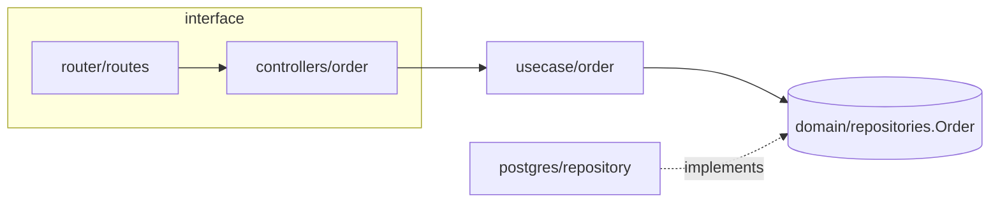

# Architecture Map

Procedure and output template for `arc:explore` map mode. Query syntax and counting rules:
[code-intel.md](../../_shared/code-intel.md) §2. Every row, edge and label in the output cites a
query and a file that was read.

## 1. Inventory

1. `arc-idx stats --format json`: record `total` and the top extensions in `by_extension`.
2. Find module roots: `arc-idx files <manifest> --format json` for `go.mod`, `package.json`,
   `pyproject.toml`, `Cargo.toml`, `pom.xml`, `build.gradle`, `Dockerfile`, `docker-compose`.
   Each manifest directory is a candidate module; a monorepo gets one row per root.
3. Size the map:
   - IF `total` files > 2000 or there are more than 8 module roots THEN map level 1 (module roots
     only), then level 2 (packages) only for the module the question names.
   - ELSE map level 2 for every module.
   - IF doctor lists a code-only profile THEN pass `--profile <name>` to `stats` and `files`.
4. Per module at level 2: `arc-idx files <module-path>/ --format json`, grouped by directory
   (packages). Never list directories recursively with shell tools.

## 2. Entry points

Run per module, read each hit, record `file:line`:

```bash
arc-idx symbol main --exact --kind func --lang go --format json        # Go binaries
arc-idx search 'lang:go case:yes ^package main$' --format json
arc-idx search 'lang:go case:yes \.(GET|POST|PUT|PATCH|DELETE|Group|Handle|HandleFunc)\(' --format json   # HTTP routes
arc-idx search 'case:yes (cron\.New|AddFunc|@Scheduled|schedule\.every)' --format json                 # scheduled jobs
arc-idx search 'case:yes (Subscribe|Consume|NewConsumer|RegisterHandler)\(' --format json               # queue consumers
arc-idx ast --lang go 'cobra.Command{$$$}' --format json                                             # CLI commands
arc-idx search 'lang:go case:yes (wire\.Build|fx\.Provide)\(' --format json                          # composition root
arc-idx search 'lang:python case:yes (__main__|APIRouter\(|@app\.(get|post|put|delete)\()' --format json
arc-idx search 'case:yes (createFileRoute|createRootRoute|createBrowserRouter)\(' --format json         # frontend routes
```

- Adapt the route pattern to the router the module imports (read one router file first).
- IF routes are registered from a table, config or string keys THEN search the registration string
  and list the route as `dynamic — confirm at runtime` when the handler stays unresolved.
- An entry point without a reachable handler chain is still listed, marked `no chain found`.

## 3. Layer labeling

1. Go backend: compare each package directory with
   [go-backend-structure.md](../../_shared/conventions/go-backend-structure.md) §2 (layout) and [go-backend.md](../../_shared/conventions/go-backend.md) §4 (responsibilities).
   Label it with the convention layer (`domain/entities`, `usecase/<module>`,
   `interface/restful/controllers`, `infrastructure/gateways`, `wire`, …).
2. Frontend: compare `src/` with [frontend.md](../../_shared/conventions/frontend.md) §8 (layout:
   `api/`, `components/`, `components/ui/`, `hooks/`, `lib/`, `routes/`, `schemas/`, `stores/`) and
   §3 (state ownership).
3. IF the repository follows its own established layout THEN label by role (`transport`,
   `application`, `domain`, `persistence`, `integration`, `composition root`, `ui`, `state`) and
   write `local convention` in the layer column; do not report the difference as a defect.
4. IF a package's role cannot be decided from its entry points, imports and file names THEN label
   it `unmapped` with the reason.

## 4. Dependency direction

1. For each rule in go-backend.md §3, run one query per forbidden import, restricted to the source
   layer:

```bash
arc-idx search 'lang:go case:yes f:internal/domain/ /internal/(infrastructure|usecase|interface)/' --format json
arc-idx search 'lang:go case:yes f:internal/domain/ (gin-gonic/gin|jackc/pgx|go-redis|casbin)' --format json
arc-idx search 'lang:go case:yes f:internal/usecase/ (\"net/http\"|gin-gonic/gin|jackc/pgx|\"database/sql\")' --format json
arc-idx search 'lang:go case:yes f:internal/interface/restful/controllers/ (/domain/repositories|jackc/pgx|\"database/sql\")' --format json
arc-idx search 'lang:go case:yes f:/dto/ /internal/(domain|usecase)/' --format json
```

2. Frontend: `search 'f:src/components/ui/ case:yes /(api|stores)/'`; server state copied into a
   store: `search 'f:src/stores/ case:yes (useQuery|fetch\()'`.
3. Every hit is read and recorded as a violation `file:line`, or dismissed with the reason (comment,
   test file, string literal).
4. Module-level edges (level 1): one `search` per pair for the other module's import path or client
   package; draw an edge only for a hit.

## 5. Output template

~~~markdown
## Architecture map: <repository or module> (HEAD <short sha>, arc-idx <version>)

Scope: <paths> · Profile: <name or all> · Level: <1|2> · Files: <stats total>

### Modules

| Module / package | Path | Layer (convention §) | Entry points (file:line) | Depends on | Evidence |
|---|---|---|---|---|---|
| order usecase | internal/usecase/order | usecase/<module> (go-backend §4) | — | domain/repositories | Q4, read main.go:12 |

### Diagram



### Dependency direction

| Rule (source) | Query | Hits | Violations (file:line) |
|---|---|---|---|
| domain imports no infrastructure (go-backend §3) | Q7 | 0 | none (query Q7) |

### Unresolved / dynamic

- <item> — dynamic — confirm at runtime (query Qn)

### Queries

Q1 stats --format json → 412 files
Q2 files go.mod → 1 → go.mod
~~~

Diagram rules:

- Solid edges only for import or call hits; dotted edges for interface implementations and
  dynamic links.
- IF the diagram would exceed 25 nodes THEN group nodes into one subgraph per layer, or draw level 1
  only and keep level 2 in the module table.
- IF the host cannot render Mermaid THEN replace it with an indented text tree in the same order.
