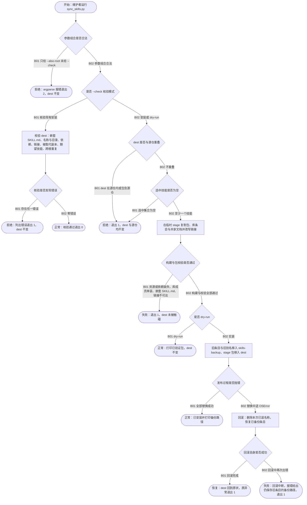

# FLOW-001 技能打包安装与核验

```text
FLOW-001 技能打包安装与核验 · 主业务流 · revision ff3ef7b+worktree（2026-10-14，含回滚报错修复） · status current
目标与价值：把本仓技能源（Arc/ 与垂直家族）打成可被宿主发现的完整包，装进 ~/.agents/skills；
  装坏时目标目录保持原状，核验能发现断链、重复发现名和被路由取代的独立副本。
触发与角色：维护者在本仓运行 scripts/sync_skills.py（安装 / --dry-run / --check）。
前置条件：.venv 有 PyYAML；技能源可解析；--dest 不与源仓重叠。
入口：scripts/sync_skills.py:341 main
模块与存储：sync_skills.py（list_skill_dirs:44、build_installation:183、validate_installation:127、
  publish_installation:312、validate_discovery:97）；src/arc_core/infrastructure/markdown.py（链接、frontmatter）；
  存储 = 临时 stage 目录、--dest（默认 ~/.agents/skills）、--dest 同级 skills-backup-*/。
关键输入：--family / --only（选中技能）、--naming dash|colon、--dest、--dry-run、--check、--also-root。
步骤：
  N01 参数组合 :352（--also-root 仅限 --check，argparse 报错退出 2）
  N02 --check 分支 :356-379 · 读 dest · 写无 · 失败：错误列表退出 1
  N03 目标重叠 :380 · 失败：ValueError 退出 1
  N04 选中为空 :383
  P1 build_installation :183-309 · 读源 · 写临时 stage · 链接改写 :288-301 · 失败：ValueError
  N05 包校验 :306-308
  N06 dry-run :389
  P2 publish_installation :312-331 · 旧条目与旧别名移入 skills-backup-*，stage 包 rename 进 dest
  P3 回滚 :332-343 · 删已装、恢复已备份、异常上抛；回滚本身失败时抛 OSError 并给出备份路径
状态：无持久状态机；结果由 dest 目录内容与 skills-backup-* 表示。
正常终点：安装完成并打印备份路径；dry-run 只验证；--check 通过。
失败条件：源资源缺失、依赖缺失、库成员单装、嵌套 SKILL.md、链接不可达、发布中途 OSError。
事务边界：stage 构建与校验全部成功前不触碰 dest；发布阶段逐名 rename，失败按已记录名单回滚。
幂等 / 重试 / 并发：重复安装同一版本结果相同（每次新建备份目录）；无锁，两个并发安装可交错（未处理，见缺口）。
观测点：dest 目录树快照、skills-backup-* 内容、退出码、stderr 错误文本、sync_skills.py --check。
待确认：skills-backup-* 无保留策略，会无限累积（:315）。
```



| 终点 | 结果 | 闭环 | 观测点 |
|---|---|---|---|
| FLOW-001-T01 | 参数错误 | 拒绝 | 退出 2；dest 前后快照一致 |
| FLOW-001-T02 | 核验失败 | 拒绝 | 退出 1；stderr 列出每条错误；dest 前后一致 |
| FLOW-001-T03 | 核验通过 | 正常 | 退出 0；stdout `Installation validation passed` |
| FLOW-001-T04 | 拒绝安装 | 拒绝 | 退出 1；dest 与源仓前后一致 |
| FLOW-001-T05 | 构建失败 | 失败 | 退出 1；dest 只含原有条目 |
| FLOW-001-T06 | dry-run 完成 | 正常 | 退出 0；`Dry run: destination unchanged`；dest 前后一致 |
| FLOW-001-T07 | 安装完成 | 正常 | dest 含选中包；旧条目在打印的备份路径；`--check` 通过 |
| FLOW-001-T08 | 发布失败已回滚 | 恢复 | 原条目内容恢复；本次新名称不存在；异常文本 |
| FLOW-001-T09 | 回滚二次失败 | 失败 | 退出 1；错误含 `rollback failed` 与 `previous entries remain in <backup>`；旧条目完整留在该备份 |

| 分支 | 条件 | 去向 | 闭环 | 风险 | 用例 | 绑定 | 判定 | 证据 |
|---|---|---|---|---|---|---|---|---|
| FLOW-001-N01-B01 | --also-root 未配 --check | T01 | 拒绝 | Low | C001-06 | tests/test_sync_skills.py::test_also_root_without_check_is_a_usage_error | PASS | logs/FLOW-001.log；变异：去掉检查后该用例失败（sensitivity-flow001.txt） |
| FLOW-001-N01-B02 | 参数组合合法 | N02 | 正常 | Low | C001-03 | tests/test_sync_skills.py::test_check_rejects_empty_installation_and_cross_root_duplicates | PASS | `pytest` 10 passed，logs/FLOW-001.log |
| FLOW-001-N02-B01 | 核验模式 | P4 | 正常 | Medium | C001-03 | tests/test_sync_skills.py::test_check_rejects_empty_installation_and_cross_root_duplicates | PASS | logs/FLOW-001.log |
| FLOW-001-N02-B02 | 安装或 dry-run | N03 | 正常 | Medium | C001-01 | tests/test_sync_skills.py::test_missing_resource_fails_before_changing_destination | PASS | logs/FLOW-001.log |
| FLOW-001-N07-B01 | 存在缺失、重复或被取代条目 | T02 | 拒绝 | Medium | C001-03 | tests/test_sync_skills.py::test_check_rejects_empty_installation_and_cross_root_duplicates；::test_discovery_rejects_independent_copies_and_arc_aliases | PASS | logs/FLOW-001.log |
| FLOW-001-N07-B02 | 零错误 | T03 | 正常 | Medium | C001-03 | tests/test_sync_skills.py::test_check_rejects_empty_installation_and_cross_root_duplicates | PASS | logs/FLOW-001.log |
| FLOW-001-N03-B01 | dest 与源仓重叠 | T04 | 拒绝 | High | C001-07 | tests/test_sync_skills.py::test_destination_overlapping_the_source_is_refused_without_moving_anything | PASS | logs/FLOW-001.log；变异：去掉守卫后 2 例失败 |
| FLOW-001-N03-B02 | 不重叠 | N04 | 正常 | Medium | C001-01 | tests/test_sync_skills.py::test_missing_resource_fails_before_changing_destination | PASS | logs/FLOW-001.log |
| FLOW-001-N04-B01 | 选中集合为空 | T04 | 拒绝 | Low | C001-08 | tests/test_sync_skills.py::test_empty_selection_is_refused | PASS | logs/FLOW-001.log；变异：去掉检查后失败 |
| FLOW-001-N04-B02 | 至少一个技能 | P1 | 正常 | Low | C001-02 | tests/test_sync_skills.py::test_selected_installation_contains_transitive_resources_and_matching_metadata | PASS | logs/FLOW-001.log |
| FLOW-001-N05-B01 | 资源、依赖、库成员、嵌套或链接错误 | T05 | 失败 | High | C001-01 | tests/test_sync_skills.py::test_missing_resource_fails_before_changing_destination；::test_missing_declared_skill_leaves_destination_unchanged；::test_library_entries_cannot_be_installed_alone；::test_nested_skill_files_fail_installation_validation | PASS | logs/FLOW-001.log |
| FLOW-001-N05-B02 | 构建与校验通过 | N06 | 正常 | Medium | C001-02 | tests/test_sync_skills.py::test_selected_installation_contains_transitive_resources_and_matching_metadata | PASS | logs/FLOW-001.log |
| FLOW-001-N06-B01 | dry-run | T06 | 正常 | Medium | C001-09 | tests/test_sync_skills.py::test_dry_run_builds_and_validates_without_touching_the_destination | PASS | logs/FLOW-001.log；变异：dry-run 失效后失败 |
| FLOW-001-N06-B02 | 实装 | P2 | 正常 | High | C001-04 | tests/test_sync_skills.py::test_publish_archives_old_aliases_without_following_links | PASS | logs/FLOW-001.log |
| FLOW-001-N08-B01 | 全部替换成功 | T07 | 正常 | High | C001-04 | tests/test_sync_skills.py::test_publish_archives_old_aliases_without_following_links | PASS | logs/FLOW-001.log |
| FLOW-001-N08-B02 | 替换中途 OSError | P3 | 恢复 | High | C001-05 | tests/test_sync_skills.py::test_publish_failure_restores_previous_installation | PASS | logs/FLOW-001.log |
| FLOW-001-N09-B01 | 回滚完成 | T08 | 恢复 | High | C001-05 | tests/test_sync_skills.py::test_publish_failure_restores_previous_installation | PASS | logs/FLOW-001.log |
| FLOW-001-N09-B02 | 回滚中再次出错 | T09 | 失败 | Low | C001-10 | tests/test_sync_skills.py::test_failed_rollback_names_the_backup_that_still_holds_the_previous_entries | PASS | logs/FLOW-001.log；修复前红灯：报错只有 `simulated failure` |

## 用例

| 用例 | 分支 | 前置状态 | 触发 | 断言（EXPECTED / FORBIDDEN） | 清理 |
|---|---|---|---|---|---|
| C001-01 | N02-B02、N03-B02、N05-B01 | 临时源缺 docs/detail.md 或缺声明依赖；dest 只有 `unchanged` | `main(--only arc:one --dest …)` | 退出 1；dest 目录列表仍只有 `unchanged`（前后快照） | tmp_path |
| C001-02 | N04-B02、N05-B02 | 临时源 arc:one 依赖 arc:two 并链接共享文档 | `build_installation` | 包含两个包；共享文档复制到 `references/_shared/`；链接改写；agents 提示改名 | tmp_path |
| C001-03 | N01-B02、N02-B01、N07-* | 空 dest；随后装入；再加 colon 命名副本 | `main(--check …)`、`--also-root` | 空 → 退出 1 且报 missing expected；装后 → 0；跨根重复 → 1 且报 duplicate | tmp_path |
| C001-04 | N06-B02、N08-B01 | dest 有旧别名符号链接、旧目录内含本地笔记、无关目录 | `publish_installation` | 旧条目原样进备份（链接不被跟随）；无关目录保留；`validate_installation` 为空 | tmp_path |
| C001-05 | N08-B02、N09-B01 | dest 有旧 arc-one/old；第 3 次 `Path.replace` 抛 OSError | `publish_installation` | 抛出原异常；arc-one/old 内容恢复；arc-two 不存在 | tmp_path |
| C001-06 | N01-B01 | 无 | `main(--dest … --also-root …)` | SystemExit 2；dest 未创建 | tmp_path |
| C001-07 | N03-B01 | dest 为源仓子目录，或为源仓父目录 | `main(--only arc:one --dest …)` | 退出 1；stderr `must not overlap`；整个 tmp 树前后快照一致 | tmp_path |
| C001-08 | N04-B01 | 源只有 Arc 家族；dest 只有 `unchanged` | `main(--family Android …)` | 退出 1；`no skills selected`；dest 不变 | tmp_path |
| C001-09 | N06-B01 | dest 有旧 arc-one/old | `main(--only arc:one --dry-run …)` | 退出 0；`Verified 2 packages` 与 `Dry run`；tmp 树前后一致 | tmp_path |
| C001-10 | N09-B02 | 第 3 次及之后的 `Path.replace` 都抛错 | `publish_installation` | OSError 含 `rollback failed`；按报错里的路径能找到完整的 arc-one/old | tmp_path |

## 测试矩阵（维度适用性）

| 维度 | 适用 | 说明 |
|---|---|---|
| A 正常 | applies | C001-02、C001-04 |
| B 参数与规则 | applies | C001-06、C001-08 |
| C 状态与生命周期 | n/a: 无持久状态机 | 以目录内容表示结果 |
| D 事务与一致性 | applies | stage 先验后发布（C001-01）；发布中途失败回滚（C001-05） |
| E 幂等与并发 | applies | 重复安装未单测；并发安装未处理 → 风险登记 |
| F 超时与外部依赖 | n/a: 无网络或外部服务 | 文件系统错误归入 D |
| G 权限 | unknown | dest 无写权限时的行为未测，归 Low |
| H 补偿与恢复 | applies | C001-05；回滚二次失败报出备份路径（C001-10），仍需人工恢复 |

剩余风险：回滚二次失败只报出备份位置，不自动恢复；备份目录无保留策略；并发安装未处理。
