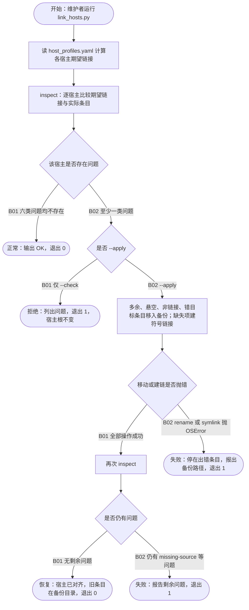

# FLOW-002 宿主链接治理

```text
FLOW-002 宿主链接治理 · 主业务流 · revision ff3ef7b+worktree（2026-10-14，含 apply 失败报错修复） · status current
目标与价值：让 Claude、Codex、Grok 三个宿主的技能根只含 host_profiles.yaml 声明的入口，
  且每个入口是指向 ~/.agents/skills（或 external_targets）的符号链接；多余条目移入备份，不删除。
触发与角色：维护者运行 scripts/link_hosts.py --check 或 --apply（可加 --host 限定）。
前置条件：FLOW-001 已安装源包；schemas/host_profiles.yaml 可解析。
入口：scripts/link_hosts.py:57 main
模块与存储：desired_links:24（profiles + extra + external_targets）、inspect:38（六类问题）；
  存储 = 各宿主技能根、~/.skills-backup/<时间戳>-link-hosts/<host>/。
步骤：
  P1 计算期望链接 :65-66
  P2 inspect :38-54 · missing-source / missing / not-a-link / wrong-target / dangling / unmanaged
  N02 --apply :73
  P3 移动与建链 :74-86 · unmanaged、dangling、not-a-link、wrong-target 移入备份；missing、not-a-link、wrong-target 建链；OSError 时停止并报出备份路径，退出 1
  P4 再次 inspect :83
正常终点：所有宿主 OK，退出 0。
失败条件：源包缺失（missing-source，--apply 不处理）；移动或建链抛 OSError（停在该条目，退出 1）。
事务边界：无；逐条移动与建链，中途异常留下部分完成状态，已移条目在报出的备份目录。
幂等 / 重试 / 并发：--apply 再跑一次只处理剩余问题（幂等）；同秒内两次运行共用一个备份目录名（未处理）。
观测点：每个宿主一行状态、退出码、备份目录内容、宿主根的链接目标。
待确认：missing-source 是否应在 --apply 前整体拒绝；中途失败后没有自动还原命令。
```



| 终点 | 结果 | 闭环 | 观测点 |
|---|---|---|---|
| FLOW-002-T01 | 宿主一致 | 正常 | 退出 0；每行 `OK` |
| FLOW-002-T02 | 漂移已报告 | 拒绝 | 退出 1；问题列表；宿主根前后快照一致 |
| FLOW-002-T03 | 漂移已修复 | 恢复 | 退出 0；被移条目在 `~/.skills-backup/<ts>-link-hosts/<host>/`；链接指向期望目标 |
| FLOW-002-T04 | 无法自动修复 | 失败 | 退出 1；剩余问题类型 |
| FLOW-002-T05 | 中途异常 | 失败 | 退出 1；输出出错条目、错误与 `entries moved so far are in <backup>`；无 traceback |

| 分支 | 条件 | 去向 | 闭环 | 风险 | 用例 | 绑定 | 判定 | 证据 |
|---|---|---|---|---|---|---|---|---|
| FLOW-002-N01-B01 | 六类问题均不存在 | T01 | 正常 | Medium | C002-01 | tests/test_link_hosts.py::test_aligned_host_reports_ok_and_changes_nothing | PASS | logs/FLOW-002.log |
| FLOW-002-N01-B02 | 至少一类问题 | N02 | 正常 | Medium | C002-02 | tests/test_link_hosts.py::test_check_lists_every_drift_kind_without_touching_the_host | PASS | logs/FLOW-002.log |
| FLOW-002-N02-B01 | 仅 --check | T02 | 拒绝 | Medium | C002-02 | tests/test_link_hosts.py::test_check_lists_every_drift_kind_without_touching_the_host | PASS | logs/FLOW-002.log；变异：错目标检测失效后失败（sensitivity-flow002.txt） |
| FLOW-002-N02-B02 | --apply | P3 | 正常 | High | C002-03 | tests/test_link_hosts.py::test_apply_moves_drift_into_backup_and_links_the_declared_entries | PASS | logs/FLOW-002.log；变异：删除代替备份、不建链，各 2 例失败 |
| FLOW-002-N03-B01 | 全部操作成功 | P4 | 正常 | High | C002-03 | tests/test_link_hosts.py::test_apply_moves_drift_into_backup_and_links_the_declared_entries | PASS | logs/FLOW-002.log |
| FLOW-002-N03-B02 | rename 或 symlink 抛 OSError | T05 | 失败 | Medium | C002-05 | tests/test_link_hosts.py::test_apply_failure_stops_and_names_the_backup_holding_moved_entries | PASS | logs/FLOW-002.log；修复前红灯：未捕获 OSError |
| FLOW-002-N04-B01 | 无剩余问题 | T03 | 恢复 | High | C002-03 | tests/test_link_hosts.py::test_apply_moves_drift_into_backup_and_links_the_declared_entries | PASS | logs/FLOW-002.log |
| FLOW-002-N04-B02 | 仍有 missing-source 等问题 | T04 | 失败 | Medium | C002-04 | tests/test_link_hosts.py::test_missing_source_is_reported_and_never_linked | PASS | logs/FLOW-002.log |

## 用例

| 用例 | 分支 | 前置状态 | 触发 | 断言（EXPECTED / FORBIDDEN） | 清理 |
|---|---|---|---|---|---|
| C002-01 | N01-B01 | 临时 profiles：一个宿主根，期望链接全部正确 | `main(--check --profiles tmp)` | 退出 0；输出 `OK`；根目录前后一致 | tmp_path |
| C002-02 | N01-B02、N02-B01 | 根中各放一个 unmanaged 目录、悬空链接、错目标链接、普通目录占位 | `--check` | 退出 1；六类中出现的类型都被列出；根目录前后快照一致 | tmp_path |
| C002-03 | N02-B02、N03-B01、N04-B01 | 同 C002-02，HOME 指向 tmp | `--apply` | 退出 0；每个被移条目原样出现在备份目录；期望名称都是指向正确目标的链接；无条目被删除 | tmp_path |
| C002-04 | N04-B02 | 期望源目录缺 SKILL.md | `--apply` | 退出 1；报 `missing-source`；该名称不建链；其他名称照常建链 | tmp_path |
| C002-05 | N03-B02 | 同 C002-02；第 2 次 `Path.rename` 抛 OSError | `--apply` | 退出 1；输出错误与备份路径；备份目录只有第 1 个被移条目 | tmp_path |

## 测试矩阵（维度适用性）

| 维度 | 适用 | 说明 |
|---|---|---|
| A 正常 | applies | C002-01 |
| B 参数与规则 | applies | profiles 引用不存在的 profile（KeyError）未处理，登记为待确认 |
| C 状态与生命周期 | n/a: 无持久状态 | |
| D 事务与一致性 | applies | 无事务；中途异常停止并报出备份位置（C002-05） |
| E 幂等与并发 | applies | --apply 重跑不再移动、不新建备份（C002-03）；同秒两次运行共用备份名未处理 |
| F 超时与外部依赖 | n/a: 本机文件系统 | |
| G 权限 | unknown | 宿主根不可写时未测 |
| H 补偿与恢复 | applies | 备份目录即恢复手段；无自动还原命令 |

剩余风险：测试在临时目录用虚构 profile 运行，未对真实宿主执行 `--apply`；中途失败无自动还原。
