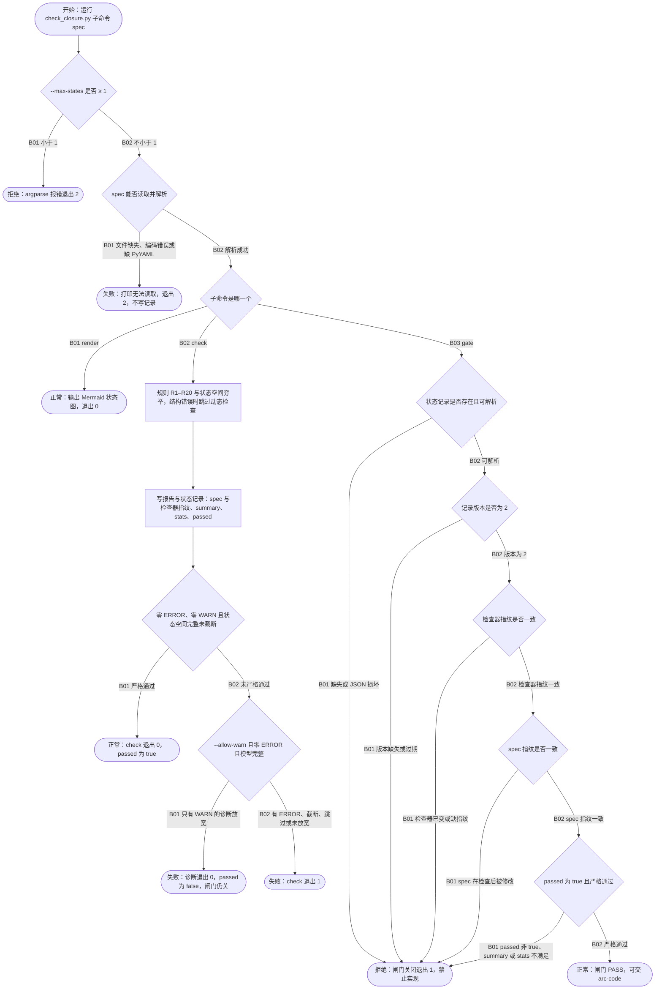

# FLOW-003 业务闭环模型闸门

```text
FLOW-003 业务闭环模型闸门 · 主业务流 · revision ff3ef7b+worktree（2026-10-14） · status current
目标与价值：arc-plan model 模式对业务闭环 spec 做静态规则与状态空间检查，只有严格通过且 spec 与检查器
  均未改动时才放行 arc-code 实现被建模的行为；防止旧检查、诊断放宽或截断被当作通过。
触发与角色：arc-plan（model）运行 check；arc-code 实现前运行 gate；任何人运行 render 生成状态图。
前置条件：spec 为 YAML（需 PyYAML）或 JSON。
入口：Arc/arc:plan/scripts/closure/check_closure.py:825 main
模块与存储：load_spec:110、run_checks:702、strict_passed:743、render_mermaid:810；
  存储 = 报告 04-closure-report.md 与状态记录 .closure-status.json（或 --report / --status 指定路径）。
步骤：
  N01 --max-states ≥ 1 :835
  N02 读 spec :841-845（失败退出 2）
  N03 子命令 gate :846 / render :867 / 其余为 check
  P1 规则 R1–R20 + 状态空间穷举；结构错误则跳过动态检查 :702-716
  P2 先写报告 :875，再写状态记录 :877（spec_sha256、checker_sha256、summary、stats、passed）
  N04 严格通过 :743-747；N05 --allow-warn 诊断 :895
  N06–N10 gate 依次核对：记录可读 :847-852、版本 :853、检查器指纹 :856、spec 指纹 :859、严格通过 :862
正常终点：check 严格通过（退出 0，passed=true）；gate PASS（退出 0）；render 输出状态图。
失败条件：spec 不可读、规则 ERROR/WARN、状态空间截断或跳过、记录缺失或过期、指纹不符。
事务边界：check 先写报告再写状态记录；gate 只读。
幂等：同一 spec 与检查器重复 check 结果相同；gate 无副作用。
观测点：退出码、stdout 闸门文字、.closure-status.json 字段。
待确认：无。
```



| 终点 | 结果 | 闭环 | 观测点 |
|---|---|---|---|
| FLOW-003-T01 | 参数错误 | 拒绝 | 退出 2；不写报告与记录 |
| FLOW-003-T02 | spec 不可读 | 失败 | 退出 2；stderr `无法读取 spec`；记录未变 |
| FLOW-003-T03 | 状态图 | 正常 | 每个实体一个 `stateDiagram-v2` 块 |
| FLOW-003-T04 | 严格通过 | 正常 | 退出 0；记录 `passed: true` 与两个指纹 |
| FLOW-003-T05 | 诊断放宽 | 失败 | 退出 0；记录 `passed: false`；随后 gate 退出 1 |
| FLOW-003-T06 | 检查未通过 | 失败 | 退出 1；报告列出 ERROR/WARN 与反例 |
| FLOW-003-T07 | 闸门关闭 | 拒绝 | 退出 1；stdout `闸门关闭` 与原因；无文件写入 |
| FLOW-003-T08 | 闸门通过 | 正常 | 退出 0；stdout `模型闸门 PASS` |

| 分支 | 条件 | 去向 | 闭环 | 风险 | 用例 | 绑定 | 判定 | 证据 |
|---|---|---|---|---|---|---|---|---|
| FLOW-003-N01-B01 | --max-states 小于 1 | T01 | 拒绝 | Low | C003-05 | selftest.py「非法参数与不可读 spec 退出 2 且不写记录」 | PASS | logs/FLOW-003-selftest.log；变异：去掉检查后失败（sensitivity-flow003.txt） |
| FLOW-003-N01-B02 | --max-states 不小于 1 | N02 | 正常 | Low | C003-01 | selftest.py「CLI 闸门绑定 spec 和检查器指纹」 | PASS | `python3 Arc/arc:plan/scripts/closure/selftest.py` 全部通过，logs/FLOW-003-selftest.log |
| FLOW-003-N02-B01 | spec 缺失、编码错误或缺 PyYAML | T02 | 失败 | Low | C003-05 | selftest.py「非法参数与不可读 spec 退出 2 且不写记录」 | PASS | logs/FLOW-003-selftest.log；变异：读失败返回 0 后失败 |
| FLOW-003-N02-B02 | 解析成功 | N03 | 正常 | Low | C003-01 | selftest.py「CLI 闸门绑定 spec 和检查器指纹」 | PASS | logs/FLOW-003-selftest.log |
| FLOW-003-N03-B01 | render | T03 | 正常 | Low | C003-06 | selftest.py「render 为每个实体输出完整状态图且不写记录」 | PASS | logs/FLOW-003-selftest.log；变异：丢弃流转行后失败 |
| FLOW-003-N03-B02 | check | P1 | 正常 | High | C003-01 | selftest.py 规则用例与「CLI 闸门绑定 spec 和检查器指纹」 | PASS | logs/FLOW-003-selftest.log |
| FLOW-003-N04-B01 | 严格通过 | T04 | 正常 | High | C003-01 | selftest.py「CLI 闸门绑定 spec 和检查器指纹」；tests/test_sync_skills.py::test_closure_package_runs_after_installation | PASS | logs/FLOW-003-selftest.log |
| FLOW-003-N04-B02 | 未严格通过 | N05 | 失败 | High | C003-02 | selftest.py「--allow-warn 和 passed 标志均不能绕过严格闸门」 | PASS | logs/FLOW-003-selftest.log |
| FLOW-003-N05-B01 | 只有 WARN 的诊断放宽 | T05 | 失败 | Critical | C003-02 | selftest.py「--allow-warn 和 passed 标志均不能绕过严格闸门」 | PASS | logs/FLOW-003-selftest.log |
| FLOW-003-N05-B02 | 有 ERROR、截断、跳过或未放宽 | T06 | 失败 | High | C003-03 | selftest.py「截断或豁免截断均不能通过闸门」；「结构豁免后未执行模型检查仍失败」 | PASS | logs/FLOW-003-selftest.log |
| FLOW-003-N03-B03 | gate | N06 | 正常 | Critical | C003-01 | selftest.py「CLI 闸门绑定 spec 和检查器指纹」 | PASS | logs/FLOW-003-selftest.log |
| FLOW-003-N06-B01 | 记录缺失或 JSON 损坏 | T07 | 拒绝 | Critical | C003-04 | selftest.py「缺失、旧版、损坏检查记录均关闭闸门」 | PASS | logs/FLOW-003-selftest.log |
| FLOW-003-N06-B02 | 可解析 | N07 | 正常 | High | C003-04 | selftest.py「缺失、旧版、损坏检查记录均关闭闸门」 | PASS | logs/FLOW-003-selftest.log |
| FLOW-003-N07-B01 | 版本缺失或过期 | T07 | 拒绝 | High | C003-04 | selftest.py「缺失、旧版、损坏检查记录均关闭闸门」 | PASS | logs/FLOW-003-selftest.log |
| FLOW-003-N07-B02 | 版本为 2 | N08 | 正常 | High | C003-01 | selftest.py「CLI 闸门绑定 spec 和检查器指纹」 | PASS | logs/FLOW-003-selftest.log |
| FLOW-003-N08-B01 | 检查器已变或缺指纹 | T07 | 拒绝 | Critical | C003-01 | selftest.py「CLI 闸门绑定 spec 和检查器指纹」；「项目工具更新保留 spec 并使旧闸门失效」 | PASS | logs/FLOW-003-selftest.log |
| FLOW-003-N08-B02 | 检查器指纹一致 | N09 | 正常 | High | C003-01 | selftest.py「CLI 闸门绑定 spec 和检查器指纹」 | PASS | logs/FLOW-003-selftest.log |
| FLOW-003-N09-B01 | spec 在检查后被修改 | T07 | 拒绝 | Critical | C003-01 | selftest.py「CLI 闸门绑定 spec 和检查器指纹」 | PASS | logs/FLOW-003-selftest.log |
| FLOW-003-N09-B02 | spec 指纹一致 | N10 | 正常 | High | C003-01 | selftest.py「CLI 闸门绑定 spec 和检查器指纹」 | PASS | logs/FLOW-003-selftest.log |
| FLOW-003-N10-B01 | passed 非 true、summary 或 stats 不满足 | T07 | 拒绝 | Critical | C003-04 | selftest.py「缺失、旧版、损坏检查记录均关闭闸门」；「--allow-warn 和 passed 标志均不能绕过严格闸门」 | PASS | logs/FLOW-003-selftest.log |
| FLOW-003-N10-B02 | 严格通过 | T08 | 正常 | Critical | C003-01 | selftest.py「CLI 闸门绑定 spec 和检查器指纹」；tests/test_sync_skills.py::test_closure_package_runs_after_installation | PASS | logs/FLOW-003-selftest.log |

## 用例

| 用例 | 分支 | 前置状态 | 触发 | 断言（EXPECTED / FORBIDDEN） | 清理 |
|---|---|---|---|---|---|
| C003-01 | 生命周期主路径 | 闭合示例 spec，无记录 | gate → check → gate → 改 spec → gate → check → gate → 改检查器 → gate → check → gate | 依次退出 1、0、0、1、0、0、1、0、0；改动后旧记录永不放行 | 临时目录 |
| C003-02 | N04-B02、N05-B01、N10-B01 | 只有 WARN 的 spec | `check --allow-warn` 后 gate；手改 `passed: true` 后 gate | check 退出 0 但记录 passed=false；gate 两次都退出 1 | 临时目录 |
| C003-03 | N05-B02 | 截断（`--max-states 1`）或结构豁免后的 spec | check 后 gate | check 退出 1；stats 为空或 truncated；gate 退出 1 | 临时目录 |
| C003-05 | N01-B01、N02-B01 | 闭合示例 spec | `check --max-states 0`；spec 写成 `{`；check 与 gate；不存在的 spec 路径 | 全部退出 2；stderr `无法读取 spec`；不生成报告与记录 | 临时目录 |
| C003-06 | N03-B01 | 闭合示例 spec | render | 每个实体一个 `stateDiagram-v2`，含初始态与每条流转 `from --> to: event[actor]`；不写记录 | 临时目录 |
| C003-04 | N06、N07、N10 | 合法记录被替换为 `[]`、`{}`、缺字段、版本旧、stats 为空、summary 为空、passed 为字符串、损坏 JSON | gate | 每种都退出 1 | 临时目录 |

## 测试矩阵（维度适用性）

| 维度 | 适用 | 说明 |
|---|---|---|
| A 正常 | applies | C003-01 |
| B 参数与规则 | applies | R1–R20 由 selftest 规则用例逐条覆盖；C003-05 |
| C 状态与生命周期 | applies | 记录的 新建 → 失效（spec 或检查器改动）→ 重建，C003-01 |
| D 事务与一致性 | applies | 报告与记录分两次写；写报告后进程中断会留下旧记录 → gate 按指纹拒绝（由 N09 覆盖） |
| E 幂等与并发 | n/a: 单进程 CLI，记录按指纹判定 | |
| F 超时与外部依赖 | n/a: 无外部依赖（PyYAML 缺失归 N02） | |
| G 权限 | n/a: 本地文件 | |
| H 补偿与恢复 | applies | 失效后重新 check 即恢复，C003-01 |

剩余风险：闸门只证明有限模型自洽，不证明需求正确或运行时行为（workflow §4）。
