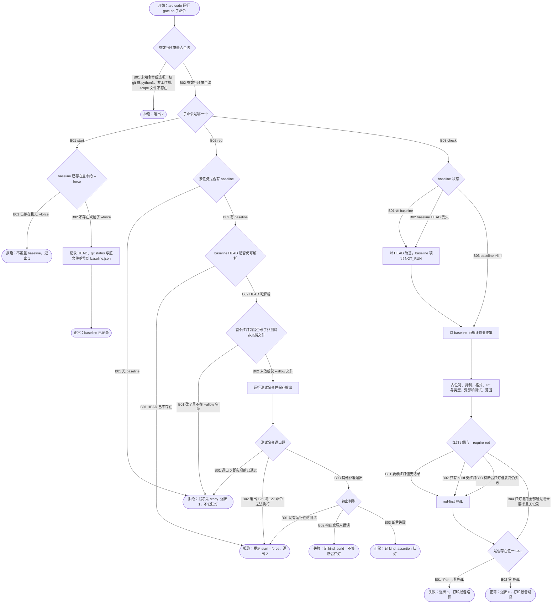

# FLOW-004 编码完成门禁

```text
FLOW-004 编码完成门禁 · 主业务流 · revision ff3ef7b+worktree（2026-10-14） · status current
目标与价值：arc-code 在改动前记录基线、在生产代码前记录失败在断言上的红灯，完成时核对变更集
  （占位符、抑制、格式、lint、受影响测试、红灯复跑、范围），任一 FAIL 不得宣称完成。
触发与角色：arc-code 运行 Arc/arc:code/scripts/gate.sh start | red | check；arc-verify red 模式交接的验收测试也经 red 记录。
前置条件：git 工作树、python3、bash 3.2+。
入口：Arc/arc:code/scripts/gate.sh:1217 main
模块与存储：cmd_start:1101、cmd_red:1115、cmd_check:1174、check_red:978、内嵌 PY_HELPER（snapshot、redprep、redrecord、analyze）；
  存储 = .arc/artifacts/<slug>/baseline.json、red/red-NNN.json、reports/gate-<ts>.txt。
步骤：
  N01 参数与环境 :1217-1306（未知命令/选项、缺 git/python3、非工作树、scope 文件不存在 → 退出 2）
  N03 start 覆盖保护 :1102-1106
  N04 red 需要 baseline :1117-1120；N05 baseline HEAD 可解析 :1121-1128
  N06 首个红灯前的生产改动 :1135-1142（--allow 例外）
  N07 测试命令退出码 :1145-1157；N08 输出判型 :1159-1170（none / build / assertion）
  N09 check 基线 :1177-1190；P5 analyze 与各检查 :1197-1209；N11 红灯复跑 :978-1013；N10 汇总 :1214
正常终点：baseline 已记录；assertion 红灯已记录；check 零 FAIL。
失败条件：见各分支；门禁从不暂存、提交、格式化或改写文件（usage 文本）。
幂等：check 只读工作树（报告写 artifacts）；红灯记录追加编号。
观测点：退出码、每行检查结果、red-NNN.json、报告文件。
待确认：red 运行测试命令无超时。
```



| 终点 | 结果 | 闭环 | 观测点 |
|---|---|---|---|
| FLOW-004-T01 | 用法或环境错误 | 拒绝 | 退出 2；stderr `gate.sh: …` |
| FLOW-004-T02 | 拒绝覆盖 | 拒绝 | 退出 1；baseline.json 前后一致 |
| FLOW-004-T03 | 基线已记录 | 正常 | baseline.json 含 head 与脏文件哈希 |
| FLOW-004-T04 | 拒绝记红灯 | 拒绝 | 退出 1；red/ 下无新记录 |
| FLOW-004-T05 | 工具或环境问题 | 失败 | 退出 2；无新红灯或提示 start --force |
| FLOW-004-T06 | 构建类红灯 | 失败 | red-NNN.json `kind: build`；后续 check --require-red 仍 FAIL |
| FLOW-004-T07 | 断言红灯 | 正常 | red-NNN.json `kind: assertion`，argv、exit、cwd |
| FLOW-004-T08 | 门禁失败 | 失败 | 退出 1；报告列出 FAIL 项 |
| FLOW-004-T09 | 门禁通过 | 正常 | 退出 0；`# summary: 0 FAIL` |

| 分支 | 条件 | 去向 | 闭环 | 风险 | 用例 | 绑定 | 判定 | 证据 |
|---|---|---|---|---|---|---|---|---|
| FLOW-004-N01-B01 | 用法或环境非法 | T01 | 拒绝 | Low | C004-01 | tests/test_gate_script.py::test_exit_codes_and_usage_errors | PASS | `pytest -k …` 11 passed，logs/FLOW-004.log |
| FLOW-004-N01-B02 | 参数与环境合法 | N02 | 正常 | Low | C004-01 | tests/test_gate_script.py::test_exit_codes_and_usage_errors | PASS | logs/FLOW-004.log |
| FLOW-004-N02-B01 | start | N03 | 正常 | Medium | C004-02 | tests/test_gate_script.py::test_start_writes_baseline_and_refuses_overwrite | PASS | logs/FLOW-004.log |
| FLOW-004-N03-B01 | 已存在且无 --force | T02 | 拒绝 | Medium | C004-02 | tests/test_gate_script.py::test_start_writes_baseline_and_refuses_overwrite | PASS | logs/FLOW-004.log |
| FLOW-004-N03-B02 | 不存在或 --force | P1 | 正常 | Medium | C004-02 | tests/test_gate_script.py::test_start_writes_baseline_and_refuses_overwrite | PASS | logs/FLOW-004.log |
| FLOW-004-N02-B02 | red | N04 | 正常 | High | C004-03 | tests/test_gate_script.py::test_red_then_green_passes_require_red | PASS | logs/FLOW-004.log |
| FLOW-004-N04-B01 | 无 baseline | T04 | 拒绝 | Medium | C004-12 | tests/test_gate_script.py::test_red_without_a_baseline_is_refused | PASS | logs/FLOW-004.log；变异：改退出码后失败（sensitivity-flow004.txt） |
| FLOW-004-N04-B02 | 有 baseline | N05 | 正常 | High | C004-03 | tests/test_gate_script.py::test_red_then_green_passes_require_red | PASS | logs/FLOW-004.log |
| FLOW-004-N05-B01 | baseline HEAD 已不存在 | T05 | 拒绝 | Low | C004-13 | tests/test_gate_script.py::test_red_with_a_vanished_baseline_head_asks_for_a_new_start | PASS | logs/FLOW-004.log；变异：改用空树后失败 |
| FLOW-004-N05-B02 | HEAD 可解析 | N06 | 正常 | High | C004-03 | tests/test_gate_script.py::test_red_then_green_passes_require_red | PASS | logs/FLOW-004.log |
| FLOW-004-N06-B01 | 首个红灯前改了生产文件 | T04 | 拒绝 | Critical | C004-04 | tests/test_gate_script.py::test_red_refuses_production_edits_before_the_first_failing_test | PASS | logs/FLOW-004.log |
| FLOW-004-N06-B02 | 未改或仅 --allow 文件 | P2 | 正常 | High | C004-03 | tests/test_gate_script.py::test_red_then_green_passes_require_red | PASS | logs/FLOW-004.log |
| FLOW-004-N07-B01 | 实现前已通过 | T04 | 拒绝 | Critical | C004-05 | tests/test_gate_script.py::test_red_refuses_a_command_that_already_passes | PASS | logs/FLOW-004.log |
| FLOW-004-N07-B02 | 退出 126 或 127 | T05 | 失败 | Medium | C004-14 | tests/test_gate_script.py::test_red_command_that_cannot_run_is_a_harness_error | PASS | logs/FLOW-004.log；变异：不识别 127 后失败 |
| FLOW-004-N07-B03 | 其他非零退出 | N08 | 正常 | High | C004-03 | tests/test_gate_script.py::test_red_then_green_passes_require_red | PASS | logs/FLOW-004.log |
| FLOW-004-N08-B01 | 没有运行任何测试 | T05 | 失败 | High | C004-06 | tests/test_gate_script.py::test_red_rejects_a_selector_that_runs_no_test | PASS | logs/FLOW-004.log |
| FLOW-004-N08-B02 | 构建或导入错误 | T06 | 失败 | High | C004-07 | tests/test_gate_script.py::test_build_error_red_needs_a_stub_and_an_assertion_red | PASS | logs/FLOW-004.log |
| FLOW-004-N08-B03 | 断言失败 | T07 | 正常 | High | C004-03 | tests/test_gate_script.py::test_red_then_green_passes_require_red | PASS | logs/FLOW-004.log |
| FLOW-004-N02-B03 | check | N09 | 正常 | High | C004-08 | tests/test_gate_script.py::test_scope_file_fails_outside_and_passes_inside | PASS | logs/FLOW-004.log |
| FLOW-004-N09-B01 | 无 baseline | P3 | 正常 | Medium | C004-09 | tests/test_gate_script.py::test_missing_baseline_prints_not_run_and_diffs_against_head | PASS | logs/FLOW-004.log |
| FLOW-004-N09-B02 | baseline HEAD 丢失 | P3 | 正常 | Low | C004-15 | tests/test_gate_script.py::test_check_with_a_vanished_baseline_head_diffs_against_head | PASS | logs/FLOW-004.log；变异：不记 NOT_RUN 后失败 |
| FLOW-004-N09-B03 | baseline 可用 | P4 | 正常 | High | C004-08 | tests/test_gate_script.py::test_scope_file_fails_outside_and_passes_inside | PASS | logs/FLOW-004.log |
| FLOW-004-N11-B01 | 要求红灯但无记录 | P6 | 失败 | Critical | C004-10 | tests/test_gate_script.py::test_require_red_fails_without_a_record_and_is_silent_otherwise | PASS | logs/FLOW-004.log |
| FLOW-004-N11-B02 | 只有 build 类红灯 | P6 | 失败 | Critical | C004-07 | tests/test_gate_script.py::test_build_error_red_needs_a_stub_and_an_assertion_red | PASS | logs/FLOW-004.log |
| FLOW-004-N11-B03 | 断言红灯复跑仍失败 | P6 | 失败 | High | C004-03 | tests/test_gate_script.py::test_red_then_green_passes_require_red | PASS | logs/FLOW-004.log |
| FLOW-004-N11-B04 | 复跑全部通过或未要求且无记录 | N10 | 正常 | High | C004-03 | tests/test_gate_script.py::test_red_then_green_passes_require_red；::test_require_red_fails_without_a_record_and_is_silent_otherwise | PASS | logs/FLOW-004.log |
| FLOW-004-N10-B01 | 至少一项 FAIL | T08 | 失败 | High | C004-11 | tests/test_gate_script.py::test_preexisting_dirty_markers_are_excluded_but_agent_markers_fail；::test_scope_file_fails_outside_and_passes_inside | PASS | logs/FLOW-004.log |
| FLOW-004-N10-B02 | 零 FAIL | T09 | 正常 | High | C004-08 | tests/test_gate_script.py::test_scope_file_fails_outside_and_passes_inside | PASS | logs/FLOW-004.log |

## 用例

| 用例 | 分支 | 前置状态 | 触发 | 断言（EXPECTED / FORBIDDEN） | 清理 |
|---|---|---|---|---|---|
| C004-01 | N01 | 临时 git 仓 | 无参数、未知命令、未知选项、选项错配 | 各退出 2；`--help` 退出 0 | tmp_path |
| C004-02 | N03 | 临时仓含脏文件 | start、再 start、start --force | 首次记录 head 与哈希；第二次退出 1 且文件不变；--force 覆盖 | tmp_path |
| C004-03 | 红灯到绿灯主路径 | price 脚本与失败的检查脚本 | red → check --require-red → 修实现 → check --require-red | red 记 assertion（argv、exit 1、cwd）；第一次 check red-first `FAIL(1 of 1 … still fail)` 退出 1；修后 `PASS` 退出 0 | tmp_path |
| C004-04 | N06-B01 | 先改生产文件 | red | 退出 1；无红灯记录 | tmp_path |
| C004-05 | N07-B01 | 检查脚本已能通过 | red | 退出 1；`passed before the implementation`；无记录 | tmp_path |
| C004-06 | N08-B01 | 选择器不命中测试 | red | 退出 2；无记录 | tmp_path |
| C004-07 | N08-B02、N11-B02 | 检查脚本报 ImportError | red → check --require-red | 记 `kind build`；check red-first `FAIL(no red run failed on an assertion …)` | tmp_path |
| C004-08 | N09-B03、N10-B02 | 带 scope 文件的变更 | check --scope | 范围外 FAIL 退出 1；范围内 PASS 退出 0 | tmp_path |
| C004-09 | N09-B01 | 无 baseline | check | baseline NOT_RUN；以 HEAD 计算变更 | tmp_path |
| C004-10 | N11-B01 | 无红灯记录 | check --require-red 与 check | 前者 FAIL(no red record…) 退出 1；后者不出现 red-first | tmp_path |
| C004-11 | N10-B01 | 基线前已有 TODO，基线后新增 TODO | check | 只有新增标记 FAIL | tmp_path |
| C004-12 | N04-B01 | 无 baseline，有检查脚本 | red | 退出 1；`no baseline for task r`；无红灯记录 | tmp_path |
| C004-13 | N05-B01 | baseline.json 的 head 改成不存在的提交 | red | 退出 2；提示 `start --force`；无记录 | tmp_path |
| C004-14 | N07-B02 | 有 baseline | `red -- <不存在的命令>` | 退出 2；`harness error … (exit 127)`；无记录 | tmp_path |
| C004-15 | N09-B02 | baseline head 改成不存在的提交，工作区新增 TODO | check | `baseline: NOT_RUN(baseline head 000000000000 not found; using HEAD)`；按 HEAD 发现 TODO，退出 1 | tmp_path |

## 测试矩阵（维度适用性）

| 维度 | 适用 | 说明 |
|---|---|---|
| A 正常 | applies | C004-03 |
| B 参数与规则 | applies | C004-01；格式、lint、SQL lint 另有 test_gate_script 用例（未逐项入图，P5 内部） |
| C 状态与生命周期 | applies | baseline → red → check；C004-12、C004-13、C004-15 |
| D 事务与一致性 | n/a: 不改工作树（test_check_never_modifies_the_working_tree） | |
| E 幂等与并发 | applies | check 可重复；同一 slug 并发 red 的编号竞争未测（Low） |
| F 超时与外部依赖 | applies | 测试命令挂起无超时（gate 不设超时），登记为待确认 |
| G 权限 | n/a: 本地工作树 | |
| H 补偿与恢复 | applies | build 红灯 → 加桩 → 断言红灯（C004-07） |

剩余风险：P5 内部的格式、lint、受影响测试判定按语言另有用例，未展开成图；red 命令无超时。
