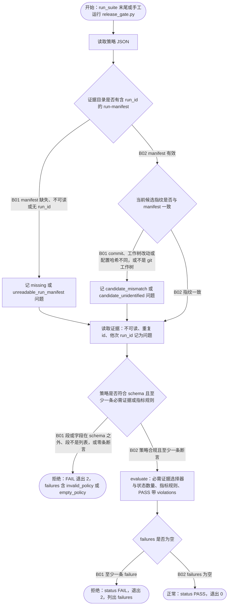

# FLOW-005 数据库发布门禁

```text
FLOW-005 数据库发布门禁 · 主业务流 · revision ff3ef7b+worktree（2026-10-14，含空策略修复） · status current
目标与价值：arc-verify db 模式用 dbqual 包把证据绑定到一次运行和一个候选版本，按策略判定 PASS/FAIL；
  任何过期、他次运行、无法识别的证据，以及什么都不检查的策略，都不能变成发布 PASS。
触发与角色：run_suite.py --gate-policy（:182-183）在流水线末尾调用，或直接运行 release_gate.py。
前置条件：证据目录由 run_suite.py 生成（run-manifest.json）；候选根是 git 工作树；端到端运行需要项目测试 PostgreSQL。
入口：Arc/arc:verify/scripts/dbqual/scripts/release_gate.py:132 main
模块与存储：sqlverify_common.py（load_run_manifest:279、verify_candidate:293、load_evidence_dir:314、begin_run）、
  release_gate.policy_problems:44、evaluate:66；schemas/gate-policy.schema.json；存储 = 证据目录 *.json、run-manifest.json、--out 报告。
步骤：
  P1 读策略 :139
  N01 run-manifest :141（缺失或无 run_id → missing/unreadable_run_manifest）
  N02 候选指纹 :142-143（commit、工作树改动、配置哈希不一致 → candidate_mismatch；非 git → candidate_unidentified）
  P4 读证据 :144（不可读、重复 id、他次 run_id → 问题）
  N03 策略检查 :44-63、:71-73（schema 之外的段或字段、段不是列表 → invalid_policy；无任何断言 → empty_policy；直接 FAIL，不评估）
  P5 evaluate :75-123（required_evidence 选择器与状态/数量、metric_rule、PASS 带 violations）
  N04 failures 是否为空 :125
正常终点：PASS 且退出 0；FAIL 退出 2。
失败条件：见分支。
同包兄弟：qualification_coverage_gate.py:30-33 对没有 claim 的 manifest 判 FAIL（run_suite 在 release_gate 之前调用，未单独作图）。
事务边界：只读证据目录；--out 覆盖写报告。
幂等：同一证据与策略重复运行结果相同。
观测点：退出码、stdout JSON（status、failures、evaluated_evidence、run_id、candidate）。
外部依赖：完整 run_suite 需要测试 PostgreSQL（本次未提供，端到端 BLOCKED；本机禁止起 PostgreSQL）。
```



| 终点 | 结果 | 闭环 | 观测点 |
|---|---|---|---|
| FLOW-005-T01 | 发布证据满足策略 | 正常 | 退出 0；`status: PASS`；evaluated_evidence 非空且覆盖每条必需选择器 |
| FLOW-005-T02 | 发布证据不满足 | 拒绝 | 退出 2；failures 含类型（missing_evidence、bad_status_or_count、metric_gate、inconsistent_pass、stale_evidence、candidate_mismatch…） |
| FLOW-005-T03 | 策略不可用 | 拒绝 | 退出 2；`status: FAIL`；failures 含 `invalid_policy`（指出 key）或 `empty_policy`；evaluated_evidence 为空 |

| 分支 | 条件 | 去向 | 闭环 | 风险 | 用例 | 绑定 | 判定 | 证据 |
|---|---|---|---|---|---|---|---|---|
| FLOW-005-N01-B01 | manifest 缺失、不可读或无 run_id | P2 | 拒绝 | Critical | C005-01 | dbqual tests/test_run_binding.py::RunBindingTests::test_evidence_without_run_manifest_fails；selftest fail_closed_controls | PASS | `python -m unittest discover -s tests` 75 OK（1 skip），logs/FLOW-005-unittest.log |
| FLOW-005-N01-B02 | manifest 有效 | N02 | 正常 | High | C005-02 | dbqual tests/test_run_binding.py::RunBindingTests::test_code_change_after_run_fails_as_candidate_mismatch | PASS | logs/FLOW-005-unittest.log |
| FLOW-005-N02-B01 | 指纹不同或非 git 工作树 | P3 | 拒绝 | Critical | C005-02 | dbqual tests/test_run_binding.py::RunBindingTests::test_code_change_after_run_fails_as_candidate_mismatch；::test_unversioned_candidate_cannot_pass | PASS | logs/FLOW-005-unittest.log |
| FLOW-005-N02-B02 | 指纹一致 | P4 | 正常 | High | C005-03 | dbqual tests/test_run_binding.py::RunBindingTests::test_leftover_pass_from_earlier_run_fails_the_gate | PASS | logs/FLOW-005-unittest.log |
| FLOW-005-N03-B01 | 段或字段在 schema 之外、段不是列表，或零条断言 | T03 | 拒绝 | High | C005-05 | dbqual tests/test_run_binding.py::RunBindingTests::test_policy_that_checks_nothing_fails_closed | PASS | logs/FLOW-005-unittest.log；修复前红灯：5 个子用例中 4 个 `(0, 'PASS')`、1 个崩溃（.arc/artifacts/fix-flow-gaps/before-D1.txt） |
| FLOW-005-N03-B02 | 策略合规且至少一条断言 | P5 | 正常 | High | C005-04 | dbqual tests/test_core.py::GateTests::test_metric_rule；tests/test_run_binding.py::RunBindingTests::test_current_run_evidence_passes | PASS | logs/FLOW-005-unittest.log |
| FLOW-005-N04-B01 | 至少一条 failure | T02 | 拒绝 | Critical | C005-03 | dbqual tests/test_core.py::GateTests::test_missing_required_fails；tests/test_v4.py::ExpertReleaseGateTests::test_selector_missing_fails；::test_pass_with_violations_is_harness_contract_failure；tests/test_run_binding.py::RunBindingTests::test_leftover_pass_from_earlier_run_fails_the_gate | PASS | logs/FLOW-005-unittest.log |
| FLOW-005-N04-B02 | failures 为空 | T01 | 正常 | High | C005-04 | dbqual tests/test_core.py::GateTests::test_metric_rule；tests/test_run_binding.py::RunBindingTests::test_current_run_evidence_passes | PASS | logs/FLOW-005-unittest.log |

## 用例

| 用例 | 分支 | 前置状态 | 触发 | 断言（EXPECTED / FORBIDDEN） | 清理 |
|---|---|---|---|---|---|
| C005-01 | N01-B01 | 证据目录只有 PASS 记录，无 manifest | release_gate.py | 非零退出；failures 含 `missing_run_manifest` | 临时目录 |
| C005-02 | N02-B01 | 运行后修改候选代码，或候选不是 git 仓 | release_gate.py --root | 非零退出；`candidate_mismatch` 或 `candidate_unidentified` | 临时目录 |
| C005-03 | N02-B02、N04-B01 | 早一轮运行遗留的 PASS 证据 | 新一轮 run 后 release_gate | 遗留证据记 `stale_evidence`，门禁 FAIL | 临时目录 |
| C005-04 | N03-B02、N04-B02 | 当前运行的 PASS 证据满足必需项与指标阈值 | evaluate / release_gate.py | status PASS，退出 0 | 临时目录 |
| C005-05 | N03-B01 | 绑定当前运行的一条 FAIL 证据；策略依次为 `{}`、空段、拼错段名、拼错字段 `min_cont`、段写成对象 | release_gate.py（每次先删旧报告） | 每次退出 2、`status: FAIL`，failures 含 `empty_policy` 或 `invalid_policy`；FORBIDDEN：PASS、崩溃、沿用旧报告 | 临时目录 |
| C005-06 | 兄弟：coverage gate | manifest 为 `{}`、`claims: []`、拼错的 `claim` | qualification_coverage_gate.py | 每次退出 2、`status: FAIL`，violations 含 `declares no claims` | 临时目录 |

## 测试矩阵（维度适用性）

| 维度 | 适用 | 说明 |
|---|---|---|
| A 正常 | applies | C005-04 |
| B 参数与规则 | applies | 策略按 schema 校验（C005-05）；coverage manifest 至少一条 claim（C005-06） |
| C 状态与生命周期 | applies | begin_run 把旧证据移入 superseded/，run_id 绑定（C005-03） |
| D 事务与一致性 | applies | 证据与候选指纹一致性（C005-02） |
| E 幂等与并发 | n/a: 只读判定 | |
| F 超时与外部依赖 | applies | 端到端 run_suite 需要测试 PostgreSQL：BLOCKED (本次无项目测试库，本机禁止起 PostgreSQL) |
| G 权限 | n/a: 本地文件 | |
| H 补偿与恢复 | n/a: 判定流程无补偿 | |

剩余风险：策略声明了断言但覆盖不足属于策略编写问题，由 coverage gate 的 `strict_complete` 管；未在真实 PostgreSQL 上跑完整 run_suite。
